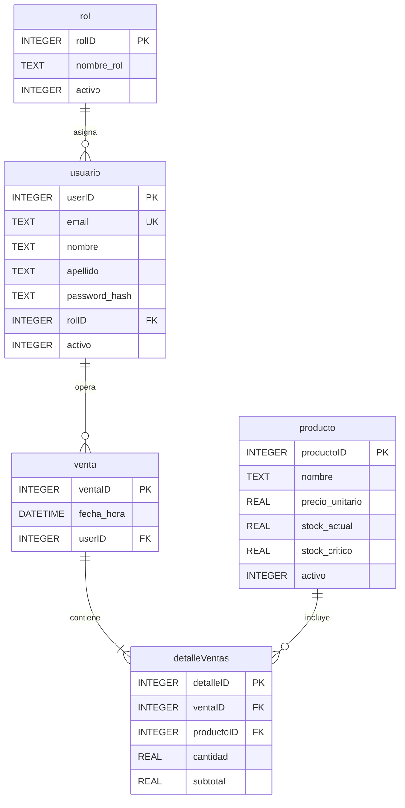

# 🔥 Fuego & Fierro — Sistema de Gestión y Punto de Venta (POS)


Aplicación de escritorio desarrollada en **Python**, **Flet** y **SQLite3** para centralizar la operación comercial, el punto de venta (POS), el control de inventario en tiempo real y el análisis financiero de la boutique de carnes **"Fuego & Fierro"**.

---

## 📋 Tabla de Contenidos

- [Contexto y Propósito](#-contexto-y-propósito)
- [Características Principales](#-características-principales)
- [Tecnologías Utilizadas](#-tecnologías-utilizadas)
- [Arquitectura y Estructura del Proyecto](#-arquitectura-y-estructura-del-proyecto)
- [Modelo de Base de Datos](#-modelo-de-base-de-datos)
- [Requisitos del Sistema](#-requisitos-del-sistema)
- [Instalación y Configuración](#-instalación-y-configuración)
- [Uso del Sistema](#-uso-del-sistema)
- [Documentación Adicional](#-documentación-adicional)

---

## 🎯 Contexto y Propósito

**Fuego & Fierro** es un comercio especializado en cortes de carne premium, achuras seleccionadas, carbón y leña. El crecimiento acelerado de la demanda generó desafíos operativos propios de la gestión manual en papel:

1. **Quiebres de stock en momentos críticos:** Falta de alertas tempranas ante el agotamiento de cortes o insumos clave durante los fines de semana.
2. **Desactualización de precios:** Errores de cobro en mostrador por variaciones frecuentes de precios no reflejadas a tiempo.
3. **Falta de trazabilidad en ventas:** Imposibilidad de auditar qué productos se vendieron, en qué cantidad, a qué hora y por qué cajero.
4. **Dificultad de proyección comercial:** Ausencia de métricas históricas para estimar compras a frigoríficos y evaluar márgenes de recaudación.

Este sistema reemplaza el registro manual por una plataforma ágil, transaccional y segura que registra ventas en pocos clics, descuenta stock automáticamente y provee reportes en tiempo real.

---

## ✨ Características Principales

### 🔐 Seguridad, Registro y Control de Acceso
- **Registro autónomo con verificación por correo (2FA):** Envío automático de un código de seguridad de 6 dígitos vía SMTP (`smtp.gmail.com`) para validar cuentas nuevas.
- **Primer usuario Administrador:** El primer usuario registrado en una base de datos limpia recibe automáticamente el rol de **Administrador** activo; los registros posteriores quedan pendientes de aprobación.
- **Encriptación de contraseñas:** Almacenamiento seguro mediante hashing con `bcrypt` (con generación de *salt*).
- **Ruteo por roles:** Redirección automática según el perfil del usuario (**Administrador** o **Cajero**).

### 🛒 Módulo de Punto de Venta — Cajero (`/cajero`)
- **Interfaz dividida (60/40):** Panel izquierdo con buscador instantáneo (*live search*) por nombre o código y grilla de tarjetas de productos; panel derecho con el ticket en curso.
- **Soporte para pesaje decimal:** Ingreso directo de cantidades en kilogramos o unidades con formato numérico en español (coma decimal).
- **Transacciones ACID y descuento de stock:** Confirmación de venta atómica que verifica disponibilidad de inventario, registra la cabecera y el detalle del ticket y descuenta el stock automáticamente.
- **Auditoría de hora oficial:** Validación de fecha y hora exacta mediante consulta de cabeceras HTTP en línea (ajustada a huso horario `UTC-3` Argentina) para garantizar la integridad cronológica de cada ticket.
- **Protección de sesión:** Alerta preventiva si el cajero intenta cerrar sesión teniendo productos cargados en el carrito.

### 🛠️ Panel de Control Administrativo (`/admin`)
- **Dashboard en tiempo real:** Tarjetas KPI con ventas acumuladas del día, contador de alertas de stock crítico e historial completo de transacciones.
- **Gestión de Inventario (ABM):**
  - Alta y edición en línea de productos (nombre, precio unitario, stock actual y umbral de stock crítico) con validaciones de formato.
  - **Baja lógica (Archivado):** Desactivación segura de productos para retirarlos del mostrador sin afectar la integridad histórica de los reportes.
  - **Semáforo de stock y filtro de reposición:** Resaltado visual en rojo de productos con `stock_actual <= stock_critico` y botón de filtrado rápido (*Solo Reposición*).
  - Búsqueda multicriterio (por ID o nombre) y ordenamiento dinámico por cualquier columna.
- **Gestión de Usuarios y Permisos:**
  - Aprobación/inhabilitación de cuentas de empleados y asignación de roles (`Administrador` / `Cajero`).
  - Notificación automática por correo electrónico en segundo plano al empleado cuando se modifican sus permisos.
- **Reportes y Estadísticas:**
  - Filtros temporales rápidos (*Hoy*, *Semana*, *Mes*, *Histórico*) y selector de rango de fechas personalizado (*DatePicker*).
  - KPIs dinámicos: **Ingresos Totales**, **Tickets Emitidos** y **Ticket Promedio**.
  - **Ranking de Productos (Top 5):** Visualización con barras de progreso de los artículos con mayor salida en kg/unidades.
  - **Auditoría por Cajero:** Tabla consolidada de tickets procesados y monto total recaudado por cada empleado.

### 👤 Autogestión de Perfil (`Mi Perfil`)
- Edición de nombre, apellido y correo electrónico para cualquier rol.
- Validación de seguridad mediante código de 6 dígitos enviado a la nueva casilla antes de aplicar un cambio de correo electrónico.
- Cambio de contraseña validando la clave actual antes de generar el nuevo hash.

---

## 🧰 Tecnologías Utilizadas

| Componente | Tecnología | Descripción |
| :--- | :--- | :--- |
| **Lenguaje** | Python 3.10+ | Lógica de negocio, concurrencia asíncrona (`asyncio`) y servicios. |
| **Interfaz Gráfica (GUI)** | [Flet](https://flet.dev/) (`0.85.3`) | Framework basado en Flutter para aplicaciones de escritorio reactivas. |
| **Base de Datos** | SQLite3 | Motor relacional local embebido (`fuego_y_fierro.db`) con soporte ACID y claves foráneas. |
| **Seguridad** | `bcrypt` | Hashing criptográfico de contraseñas. |
| **Variables de Entorno** | `python-dotenv` | Gestión de credenciales SMTP mediante archivo `.env`. |
| **Notificaciones** | `smtplib` / `email.mime` | Envío asíncrono de correos electrónicos con TLS (`smtp.gmail.com:587`). |

---

## 📁 Arquitectura y Estructura del Proyecto

```text
Carnicer-a/
├── Programa.py                                  # Punto de entrada y controlador principal de vistas (Flet UI)
├── base_de_datos.py                             # Capa de acceso a datos (DAO), esquema SQLite3, transacciones y reportes
├── ventana_mensaje.py                           # Gestor estático de diálogos modales (alertas y loaders de carga)
├── requirements.txt                             # Dependencias del entorno Python
├── Contexto.pdf                                 # Caso de estudio y problemática operativa del negocio
├── Requerimientos del usuario.pdf               # Especificación de Requerimientos de Software (SRS - IEEE 830)
├── Modelo entidad-relación.drawio               # Diagrama Entidad-Relación editable en Draw.io
└── Espacio de trabajo de la base de datos.sqbpro # Proyecto de consultas para DB Browser for SQLite
```

### Descripción de Módulos de Código
- **[`Programa.py`](Programa.py):** Contiene la clase [`Carniceria`](Programa.py#L23-L1865) y la función [`main`](Programa.py#L1870-L1883). Gestiona el enrutamiento (`/login`, `/registro`, `/validacion`, `/admin`, `/cajero`), la maquetación responsiva en Flet y la ejecución de tareas bloqueantes (SMTP y consultas de red) en hilos secundarios mediante `asyncio.to_thread`.
- **[`base_de_datos.py`](base_de_datos.py):** Contiene la clase [`BaseDeDatos`](base_de_datos.py#L6-L569). Inicializa automáticamente el archivo `fuego_y_fierro.db`, impone restricciones de integridad (`FOREIGN KEY`, `CHECK`, `UNIQUE`), y expone métodos para usuarios, catálogo, ventas transaccionales y reportes analíticos.
- **[`ventana_mensaje.py`](ventana_mensaje.py):** Contiene la clase [`GestorMensajes`](ventana_mensaje.py#L3-L104) para desplegar alertas modales tipadas (`info`, `exito`, `error`) e indicadores de progreso limpiando de forma segura el `overlay` de Flet.

---

## 🗄️ Modelo de Base de Datos

El motor SQLite3 crea automáticamente el esquema en el archivo local `fuego_y_fierro.db` al iniciar la aplicación por primera vez.



---

## 💻 Requisitos del Sistema

### Software
- **Sistema Operativo:** Windows 10 / 11 (64-bit), Linux o macOS.
- **Python:** Versión 3.10 o superior.
- **Conexión a Internet:** Requerida para el envío de códigos de verificación por correo (registro, cambio de email y notificación de permisos) y para la validación de hora oficial al registrar ventas.

### Hardware Recomendado para Terminal POS
- **Procesador:** Intel Core i3 / AMD Ryzen 3 (Mínimo) — Intel Core i5 / AMD Ryzen 5 (Recomendado).
- **Memoria RAM:** 4 GB (Mínimo) — 8 GB (Recomendado).
- **Almacenamiento:** Unidad de Estado Sólido (SSD) con al menos 5 GB libres para maximizar la velocidad de lectura/escritura en SQLite3.
- **Resolución de Pantalla:** Mínima de `1366x768`.
- **Protección Eléctrica:** Uso recomendado de UPS en la terminal de mostrador.

---

## 🚀 Instalación y Configuración

### 1. Clonar el repositorio

```bash
git clone https://github.com/Gabriel1610/Carnicer-a.git
cd Carnicer-a
```

### 2. Crear y activar un entorno virtual

**En Windows:**
```bash
python -m venv venv
venv\Scripts\activate
```

**En Linux / macOS:**
```bash
python3 -m venv venv
source venv/bin/activate
```

### 3. Instalar las dependencias

```bash
pip install -r requirements.txt
pip install bcrypt python-dotenv
```

### 4. Configurar las variables de entorno (`.env`)

Creá un archivo llamado `.env` en la raíz del proyecto para habilitar el envío de correos electrónicos mediante Gmail SMTP (se requiere una [Contraseña de Aplicación de Google](https://support.google.com/accounts/answer/185833?hl=es)):

```env
EMAIL_REMITENTE=tu_correo@gmail.com
EMAIL_PASSWORD=tu_contrasena_de_aplicacion
```

---

## ▶️ Uso del Sistema

Para iniciar la aplicación, ejecutá:

```bash
python Programa.py
```

### Flujo de Puesta en Marcha Inicial
1. **Registro del Administrador:** Al abrir el sistema por primera vez, hacé clic en *"¿No tenés cuenta? Registrate acá"*. Completá tus datos e ingresá el código de 6 dígitos enviado a tu correo. Al ser el **primer usuario registrado**, el sistema te asignará automáticamente el rol de **Administrador** activo.
2. **Carga de Catálogo Inicial:** Ingresá con tu cuenta de Administrador, dirigite a la sección **Inventario** y utilizá el botón **Nuevo Producto** para registrar los cortes, achuras e insumos con su stock físico inicial y su umbral de stock crítico.
3. **Alta de Cajeros:** Los empleados de mostrador deben registrarse desde la pantalla de inicio. Luego, como Administrador, ingresá al módulo **Usuarios**, seleccioná al empleado, asignale el rol de **Cajero** y cambiá su estado a **Activo (Aprobado)**. El empleado recibirá un correo automático confirmando su habilitación.
4. **Operación de Ventas:** Cuando un Cajero inicie sesión, accederá directamente al **Punto de Venta**, donde podrá buscar artículos, ajustar las cantidades en kg/unidades según la balanza y confirmar el cobro.

---

## 📄 Documentación Adicional

El repositorio incluye la documentación formal de ingeniería de software del proyecto:

- **[`Contexto.pdf`](Contexto.pdf):** Descripción del caso de negocio y análisis de los problemas operativos previos a la sistematización.
- **[`Requerimientos del usuario.pdf`](Requerimientos%20del%20usuario.pdf):** Especificación de Requerimientos de Software (basada en el estándar IEEE/ANSI 830-1998), detallando requerimientos funcionales (`RF01`–`RF08`), no funcionales (`RNF01`–`RNF05`), interfaces (`RI01`–`RI03`), diccionario de datos y prototipos UX.
- **[`Modelo entidad-relación.drawio`](Modelo%20entidad-relaci%C3%B3n.drawio):** Diagrama Entidad-Relación del sistema.
